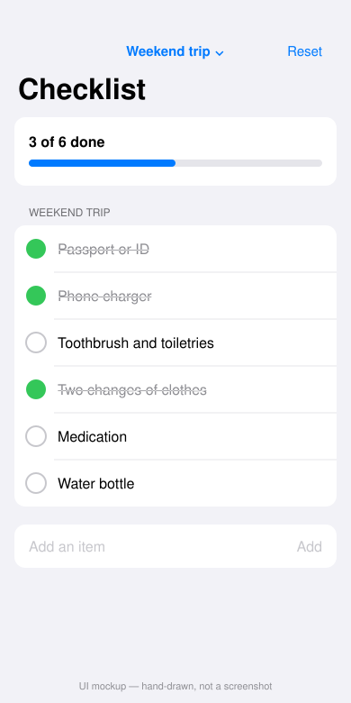

# Checklist

A single-screen SwiftUI app that loads starter checklists (trip, moving day, leaving the house), lets you tick items off with a progress bar, and add, delete or reset items.



*Hand-drawn UI mockup, not a screenshot — see Limitations.*

## How to run

Requires Swift 6+. The logic and fixture loading (`ChecklistCore`) build and test on Linux or macOS. The UI needs Xcode on macOS.

```bash
cd projects/2026-10-12-ios-checklist
swift test    # on macOS; on Linux see the note below
```

To see the screen: open `Package.swift` in Xcode, add an iOS App target that depends on the `Checklist` library, and show `ChecklistRootView()` in your own `WindowGroup` (the library also contains a `ChecklistApp` entry point). Run it in the simulator.

On Linux, `swift test` fails to build the `Checklist` UI target (`no such module 'SwiftUI'`). To run only the logic tests there, build a copy of the package without that target.

## Stack

- Swift 6, SwiftUI, `@Observable` store (`ChecklistStore`), Swift Package Manager, no dependencies
- `ChecklistCore`: Foundation-only models and rules (progress, duplicate-safe add, toggle, remove, reset)
- Starter lists read from `mock/checklists.json` (copied into `Sources/ChecklistCore/Resources/` as a package resource) through the `ChecklistRepository` protocol — a real client replaces `MockChecklistRepository` in one file
- Tests in `Tests/ChecklistCoreTests` use the `Testing` framework

## Limitations

- **The SwiftUI screen was written but not built or run.** This runner is Linux with no Xcode or simulator. `preview.svg` is a hand-drawn UI mockup. The `verify-ios` job on macOS is the first real compile of the UI.
- **Verified here:** `ChecklistCore` built and all 6 unit tests passed on Linux, using a copy of the package without the UI target.
- Changes are held in memory only; nothing is saved between launches.

- **iOS build: passing.** Compiled on macOS against the iOS 17 simulator SDK by the `verify-ios` job.
