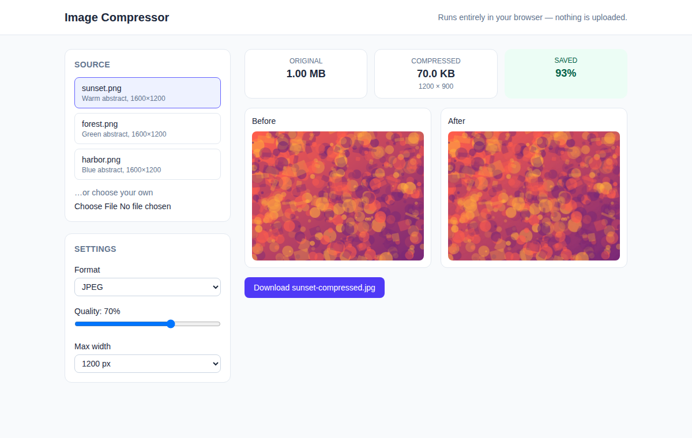

# Image Compressor

A browser tool that shrinks an image by re-encoding it as JPEG, WebP or PNG at a chosen quality and width, and shows the before/after file sizes side by side.



*Real headless-Chromium screenshot of the running build: a 1.00 MB PNG becomes a 70.0 KB JPEG (93% saved).*

## How to run

Requires Node.js 20+.

```bash
cd projects/2026-10-13-web-image-compressor   # or the repo root if published standalone
npm install
npm run dev          # http://localhost:5173
```

Production build and unit tests:

```bash
npm run build && npm run preview   # http://localhost:4173
npm test
```

## How it works

- Pick one of the bundled sample images or choose your own file.
- Format, quality and max-width controls re-run the compression instantly using a `<canvas>`; nothing leaves the browser.
- The sample list comes from `mock/images.json` through `src/services/imageSource.js`. A real image API could replace that one file as long as it keeps the `list()` and `fetchBlob()` shapes.

## Stack

Vue 3 (Composition API, `<script setup>`), Vite 7, Tailwind CSS v4, `node:test` for the pure helpers.

## Limitations

- Output format support depends on the browser (WebP encoding is not available in every browser; an error is shown instead).
- One image at a time; no batch mode or ZIP download.
- Re-encoding drops metadata (EXIF) and transparency is flattened onto white.
- The sample images are generated abstract art (~1 MB PNGs, committed under `public/samples/`).
- Verified with a headless Chromium run and screenshot plus `npm test`; not tested across other browsers.
