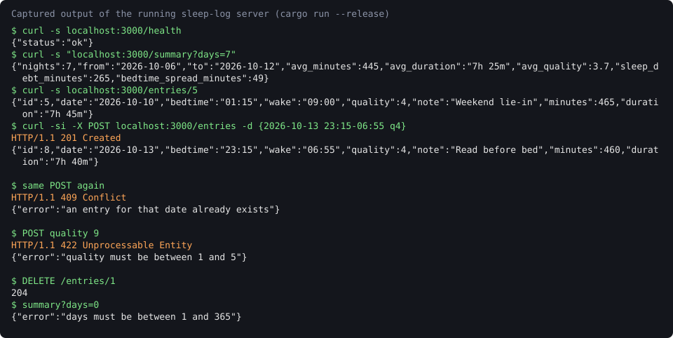

# Sleep Log API

A small Rust (Axum) service that records nightly sleep, computes duration across midnight, and summarises a window of nights with average sleep, sleep debt against an 8-hour goal, and bedtime regularity.



## How to run

```bash
cargo test                    # 6 tests: unit + every endpoint, in-process
cargo run --release           # serves http://127.0.0.1:3000 (override with ADDR=...)
```

Then, in another terminal:

```bash
curl -s localhost:3000/entries
curl -s 'localhost:3000/summary?days=7'
curl -si -X POST localhost:3000/entries -H 'content-type: application/json' \
  -d '{"date":"2026-10-13","bedtime":"23:15","wake":"06:55","quality":4,"note":"Read before bed"}'
curl -s -X DELETE localhost:3000/entries/1
```

## Endpoints

| Method & path | Result |
|---|---|
| `GET /health` | `{"status":"ok"}` |
| `GET /entries` | all entries, newest first, with `minutes` and `duration` |
| `GET /entries/{id}` | one entry, or 404 |
| `POST /entries` | 201 with the entry; 422 on bad input; 409 if that date already has one |
| `DELETE /entries/{id}` | 204, or 404 |
| `GET /summary?days=N` | stats for the N days ending at the newest entry (default 7, 1–365) |

`date` is the morning you woke up. A wake time at or before bedtime means the next day.

## Stack

Rust 2024, Axum 0.8, Tokio, Serde. Persistence sits behind the `EntryRepo` trait in `src/store.rs`; the only implementation loads `mock/entries.json` into memory, so a database-backed repo is a one-file swap.

## Limitations

- Data is in memory: changes are lost on restart, and the fixture file is never written back.
- Single user, no authentication.
- Summaries are anchored to the newest entry rather than today's date, so the fixture stays meaningful whenever you run it.
- Verified here by `cargo test` and by running the release binary with curl (the preview is that real output); no load testing.
