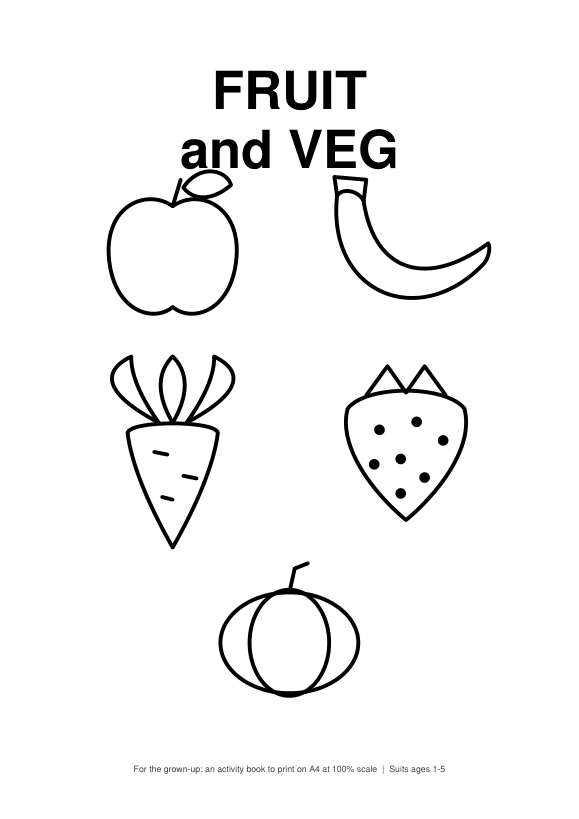
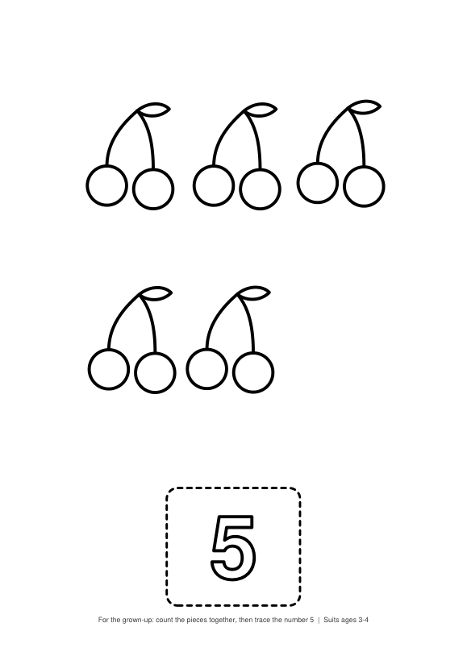
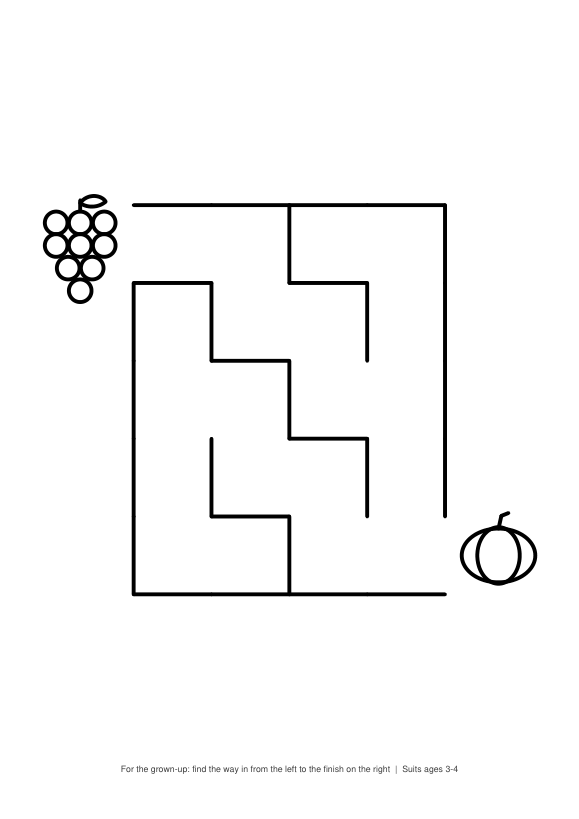
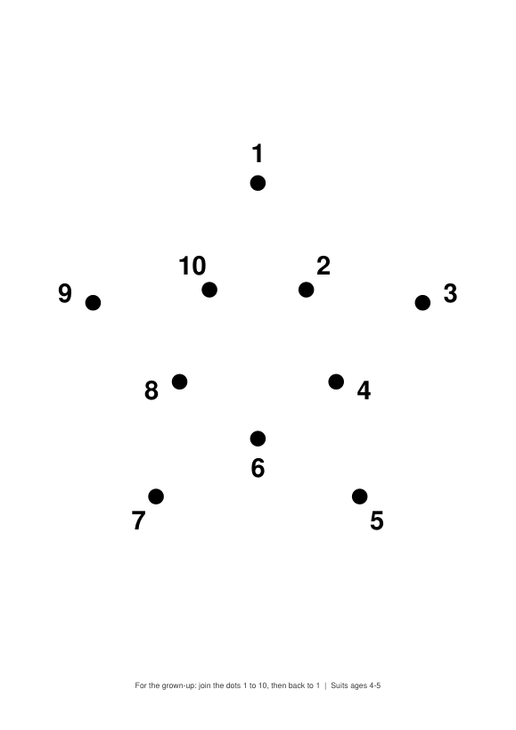

# Fruit and Veg: printable activity book (ages 1–5)

A 26-page, ink-friendly A4 activity book of tracing, colouring, counting, matching, mazes and dot-to-dot pages, drawn entirely by `generate.py`.

   

## How to run

The finished book is already in this folder: print `book.pdf` on A4, portrait, at 100% scale.

To regenerate it from a clean checkout (needs Python 3):

```bash
cd projects/2026-10-15-kidsbook-fruit-and-veg
python3 -m venv .venv && . .venv/bin/activate
pip install reportlab pymupdf
python3 generate.py                      # writes book.pdf (26 pages)
python3 render_previews.py 1 14 19 24    # optional: writes preview/page-NN.png
```

Rerunning `generate.py` gives a byte-identical `book.pdf` (fixed random seed and invariant PDF mode).

## What's inside

Pages run roughly easiest to hardest. Each carries a small note at the foot for the parent, including which ages it suits.

| Pages | Content | Ages |
|---|---|---|
| 1 | Cover | all |
| 2–3 | Trace straight lines across and down | 1–2 |
| 4–5 | Colour a big apple and banana | 1–3 |
| 6, 12 | Trace waves and zigzags | 2–5 |
| 7, 22 | Size: circle the biggest / the smallest | 2–5 |
| 8, 10, 13, 16 | Colour a strawberry, carrot, pear, pumpkin | 2–5 |
| 9, 14, 20 | Counting 3, 5 and 8, with an outlined numeral to trace | 2–5 |
| 11, 17 | Trace circles; trace square, triangle, diamond, rectangle | 2–4 |
| 15 | Matching pairs | 3–4 |
| 18 | Odd one out | 3–5 |
| 19, 25 | Mazes with wide corridors (small, then larger) | 3–5 |
| 21 | Pattern completion | 4–5 |
| 23, 24 | Dot-to-dot 1–5 and 1–10 | 3–5 |
| 26 | "Well done" certificate | all |

Design rules followed: black line art on white with no fills, strokes of at least 4pt, 15mm safe margin, no reading needed (text is only for the parent), and only generic fruit and vegetables, with no licensed characters.

## Stack

Python 3, [ReportLab](https://pypi.org/project/reportlab/) for vector PDF output, and PyMuPDF only to render the preview PNGs.

## Limitations

- Verified by generating the PDF, confirming it has 26 pages, rendering every page and checking them by eye, and checking that two runs give identical bytes. It has not been printed on a real home printer or tried with a child.
- The size-sorting pages use shapes smaller than 4cm for the "small" choices, since the contrast is the point of the exercise.
- The drawings are simple geometric outlines, so the banana and the carrot greens are stylised.
- Maze difficulty is set by grid size, not tuned with children.
- Previews are rendered with PyMuPDF. The `mock/*.json` fixtures the playbook mentions do not apply: this book has no network-shaped data.
