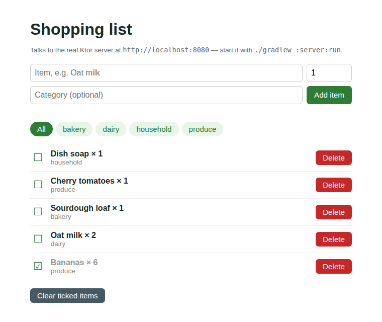

# Shared Shopping List

A shopping list you can tick off, filter by aisle and clear once you are at the till: one Kotlin domain in `shared/`, a Ktor API in `server/`, and Android, web and iOS clients that all talk to it.



*Real headless-Chromium screenshot of `webApp/` served next to the running `server/` — unticked items first, ticked ones struck through at the bottom.*

## How to run

Needs JDK 17 (and Node for the web bundle, which Gradle downloads itself; the Android SDK only for `androidApp`). From a clean checkout of this folder:

```bash
# 1. Start the API on http://localhost:8080 (seeded from mock/items.json)
./gradlew :server:run
```

```bash
# 2. In a second terminal: build and serve the web client, then open http://localhost:8000
./gradlew :webApp:jsBrowserDistribution
cd webApp/build/dist/js/productionExecutable && python3 -m http.server 8000
```

```bash
# Tests and full build (shared on JVM/Android, server, Android debug APK, web)
./gradlew build
```

```bash
# Android (emulator reaches the host server at 10.0.2.2:8080)
./gradlew :androidApp:assembleDebug
```

```bash
# iOS (macOS with Xcode only) — open iosApp/Package.swift in Xcode, or:
cd iosApp && swift test
```

### API

| Method & path | Result |
|---|---|
| `GET /items?category=produce` | `200`, unticked first then newest; `category` optional |
| `POST /items` `{"name","quantity","category"}` | `201` with the new item; `400` `{"message"}` for blank/over-60-char name, quantity outside 1–99, or malformed JSON |
| `POST /items/{id}/check` | `200` with the toggled item; `404` unknown id; `400` non-numeric id |
| `DELETE /items/{id}` | `204`; `404` unknown id |
| `DELETE /items/checked` | `200` `{"removed": n}` — drops every ticked item |

Real output from the running server (`./gradlew :server:installDist`, then `curl`):

```text
$ curl -X POST localhost:8080/items -d '{"name":"Eggs","quantity":12,"category":"Dairy Aisle"}'
HTTP/1.1 201 Created
{ "id": 6, "name": "Eggs", "quantity": 12, "category": "dairy-aisle", "checked": false, "createdAtEpochSeconds": 1792179330 }

$ curl -X POST localhost:8080/items -d '{"name":"Eggs","quantity":0}'
HTTP/1.1 400 Bad Request
{ "message": "Quantity must be between 1 and 99" }

$ curl -X POST localhost:8080/items -d '{"name":" "}'     -> 400, "Give the item a name"
$ curl -X POST localhost:8080/items -d '{"name":'         -> 400, "Request body must be JSON with name, optional quantity and category"
$ curl -X POST localhost:8080/items/2/check               -> 200, "checked": true
$ curl -X POST localhost:8080/items/99/check              -> 404, "No item with id 99"
$ curl -X POST localhost:8080/items/abc/check             -> 400
$ curl -X DELETE localhost:8080/items/5                   -> 204 No Content
$ curl -X DELETE localhost:8080/items/5                   -> 404
$ curl -X DELETE localhost:8080/items/checked             -> 200, { "removed": 2 }
$ curl "localhost:8080/items?category=Produce"            -> only "Cherry tomatoes"
```

## Stack

- **`shared/`** (`commonMain`; targets `jvm`, Android, `iosX64`/`iosArm64`/`iosSimulatorArm64`, `js(IR)`): `ShoppingItem`, `ShoppingRepository`, category normalisation and five use cases (`List`, `Add`, `ToggleChecked`, `Remove`, `ClearChecked`) returning a `ShopResult` sealed class. Unit-tested in `commonTest`.
- **`server/`**: Ktor + Netty, in-memory repository (mutex-guarded) seeded from `mock/items.json`, bundled as a classpath resource. It calls the same shared use cases the clients do.
- **`androidApp/`**: Jetpack Compose + Material 3, `ViewModel` + `StateFlow`, Ktor client behind `HttpShoppingRepository` — swap that one file for another backend.
- **`webApp/`**: Kotlin/JS, plain DOM, Ktor JS client behind `HttpShoppingRepository`, driving the shared use cases.
- **`iosApp/`**: Swift 6, SwiftUI, `@Observable`, SwiftPM, `URLSession` behind `HttpShoppingRepository`.

## Verified on this runner

- `./gradlew build` — **passes**: shared tests, 5 Ktor `testApplication` server tests, Android debug build and lint, web bundle.
- Server started and exercised with `curl` (output above); web client screenshot taken against the live server.

## Limitations

- **The iOS app was not built or run at authoring time** (Linux runner, no Xcode). The `verify-ios` job compiles it on macOS afterwards. It also does **not** link the compiled `shared` module: Kotlin/Native can only produce Apple targets on macOS and nothing here builds an `.xcframework`, so `iosApp/` is a hand-written Swift mirror of the same JSON contract and use-case rules.
- **The Android app was built (`assembleDebug`, lint) but never launched** — no emulator here.
- "Shared" means every client sees the same server-side list on refresh; there is no push or live sync between devices.
- Persistence is in-memory: restarting the server resets to the seed file. No auth, no pagination.
- The web client needs the two terminals above; the API allows any origin (CORS `anyHost`), which is fine for local dev only.

- **iOS build: passing.** Compiled on macOS against the iOS 17 simulator SDK by the `verify-ios` job.

- **iOS build: passing.** Compiled on macOS against the iOS 17 simulator SDK by the `verify-ios` job.
