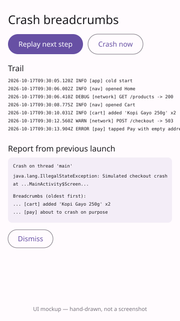

# Crash Breadcrumbs

An Android library that keeps a ring buffer of the last N things your app did and writes them next to the stack trace when the app crashes, so the next launch can show what the user did before it died.



*UI mockup (hand-drawn SVG, not a screenshot).*

## How to run

Needs JDK 17 and the Android SDK (`ANDROID_HOME` set or `local.properties` with `sdk.dir`).

```bash
./gradlew build                 # compiles the library + sample, runs the unit tests
./gradlew :breadcrumbs:test     # library unit tests only
./gradlew :sample:installDebug  # install the sample on a connected device/emulator
```

## Use it

Dependency coordinates (after `./gradlew :breadcrumbs:publishToMavenLocal`):

```kotlin
implementation("com.dailyprojects.breadcrumbs:breadcrumbs:1.0.0")
```

```kotlin
class MyApp : Application() {
    override fun onCreate() {
        super.onCreate()
        Breadcrumbs.install(this, capacity = 100)   // hooks the uncaught-exception handler
    }
}

Breadcrumbs.log("nav", "opened Cart")
Breadcrumbs.log("network", "POST /checkout -> 503", Level.WARN)

// next launch:
Breadcrumbs.pendingCrashReport()?.let { upload(it); Breadcrumbs.clearCrashReport() }
```

Public API: `Breadcrumbs` (facade), `BreadcrumbRecorder` (thread-safe ring buffer, usable without Android), `CrashReporter` (handler + report file; chains to the previously installed handler), `Breadcrumb`, `Level`.

The `sample/` app replays a scripted session from `mock/session.json` (read through the `SessionSource` interface), and has a "Crash now" button that crashes and shows the report on the next launch.

## Stack

Kotlin, Android Gradle Plugin 8.6, JUnit 4, Jetpack Compose + Material 3 (sample only). The library itself has no dependencies.

## Limitations

- Verified on this runner: `./gradlew build` passes (library, sample compile, lint, 6 unit tests). The sample was never run — there is no emulator here, and the preview is a mockup.
- Only JVM uncaught exceptions are captured; native crashes and ANRs are not.
- The report is written synchronously to a plain file in `filesDir`; breadcrumbs are in memory only, so a process kill without an exception leaves no trail.
- No PII redaction beyond message truncation — do not log secrets.
- Not published to a remote Maven repository.
