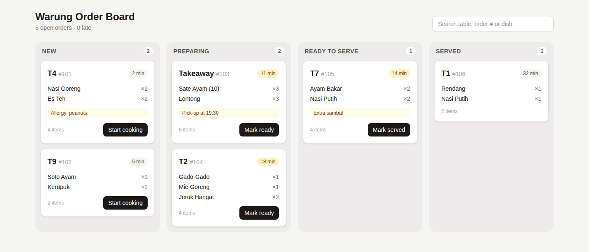

# Order Board

A React kitchen order board for a small restaurant: orders move across New → Preparing → Ready → Served columns with one tap, late tickets are flagged by age, and staff can search by table, order number or dish.



*Real headless-Chromium screenshot of the built app (also at `preview.png`).*

## How to run

```bash
cd projects/2026-10-18-freelance-order-board   # or the repo root if published standalone
npm install
npm run build        # type-checks with tsc, then builds
npm run dev          # http://127.0.0.1:5173
```

To serve the production build instead: `npm run preview` (http://127.0.0.1:4173).

## How it works

- `mock/orders.json` holds the fixture orders.
- `src/orderSource.ts` defines the `OrderSource` interface (`list`, `setStatus`) and an in-memory mock. A real API client replaces only that file's export.
- `src/board.ts` has the pure logic: next status, urgency (10+ min slow, 20+ min late), item counts, search matching.
- `src/App.tsx` and `src/OrderCard.tsx` render the board.

## Stack

React 19, Vite 7, Tailwind CSS v4, TypeScript.

## Verification

Built with `npm run build`, served with `npm run preview`, and driven in headless Chromium over the DevTools protocol:

```
before                New:2 Preparing:2 Ready to serve:1 Served:1
after "Start cooking" New:1 Preparing:3 Ready to serve:1 Served:1
search "soto"         New:1 Preparing:0 Ready to serve:0 Served:0
```

## Limitations

- State lives in memory: a reload resets the board to the fixture.
- Order age is a static number from the fixture and does not tick up live.
- No authentication, no new-order entry form, no printing of kitchen tickets.
