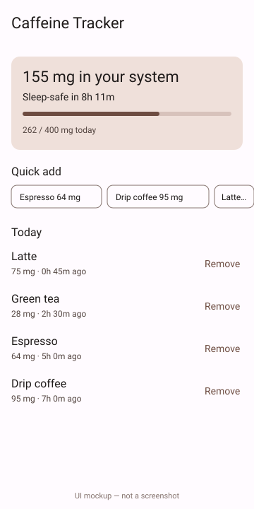

# Caffeine Tracker

An Android app that logs your coffee, tea and energy drinks and estimates how much caffeine is still active in your body and when it will drop low enough for sleep.



*UI mockup, hand-drawn — not a screenshot. The app was compiled but never launched.*

## How to run

Requires a JDK 17 and the Android SDK (`ANDROID_HOME` set, or `sdk.dir` in `local.properties`).

```bash
./gradlew assembleDebug
# install on a connected device or emulator
adb install -r app/build/outputs/apk/debug/app-debug.apk
```

## How it works

- Active caffeine uses first-order decay with a 5-hour half-life: `mg × 0.5^(minutes / 300)`.
- "Sleep-safe" is the time until the active amount falls below 50 mg.
- The daily limit (400 mg) and the drink catalogue come from `mock/caffeine.json`, read through the `CaffeineRepository` interface. Replacing `LocalCaffeineRepository` is the only change needed for a real backend.

## Stack

Kotlin, Jetpack Compose, Material 3, ViewModel + StateFlow, Gradle Kotlin DSL (AGP 8.6, Kotlin 2.0.20).

## Limitations

- `./gradlew assembleDebug` passes on the authoring runner, but there is no emulator there, so the UI has never been run or seen on a device.
- Entries are held in memory only; they reset when the app restarts.
- Added drinks are stamped "just now" and the clock does not advance while the app is open.
- The decay model is a rough estimate, not medical advice.
- No unit tests.
