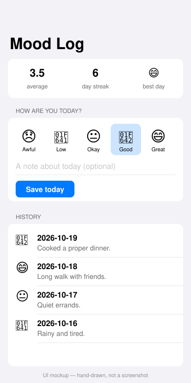

# Mood Log

A single-screen SwiftUI app where you pick today's mood and a short note, and see your average, current streak, best day and history.



*Hand-drawn UI mockup, not a screenshot — see Limitations.*

## How to run

Requires Swift 6+. The logic and fixture loading (`MoodCore`) build and test on Linux or macOS. The UI needs Xcode on macOS.

```bash
cd projects/2026-10-20-ios-mood-log
swift test    # on macOS; on Linux see the note below
```

To see the screen: open `Package.swift` in Xcode, add an iOS App target that depends on the `MoodLog` library, and show `MoodRootView()` in your own `WindowGroup` (the library also contains a `MoodApp` entry point). Run it in the simulator.

On Linux, `swift test` fails to build the `MoodLog` UI target (`no such module 'SwiftUI'`). To run only the logic tests there, build a copy of the package without that target.

## Stack

- Swift 6, SwiftUI, `@Observable` store (`MoodStore`), Swift Package Manager, no dependencies
- `MoodCore`: Foundation-only models and rules (one entry per day, streak counting across month boundaries, average, best day)
- Past entries read from `mock/entries.json` (copied into `Sources/MoodCore/Resources/` as a package resource) through the `MoodRepository` protocol — a real client replaces `MockMoodRepository` in one file
- Tests in `Tests/MoodCoreTests` use the `Testing` framework

## Limitations

- **The SwiftUI screen was written but not built or run.** This runner is Linux with no Xcode or simulator. `preview.svg` is a hand-drawn UI mockup. The `verify-ios` job on macOS is the first real compile of the UI.
- **Verified here:** `MoodCore` built and all 7 unit tests passed on Linux, using a copy of the package without the UI target.
- Entries are held in memory only; nothing is saved between launches. Days are computed in UTC.
