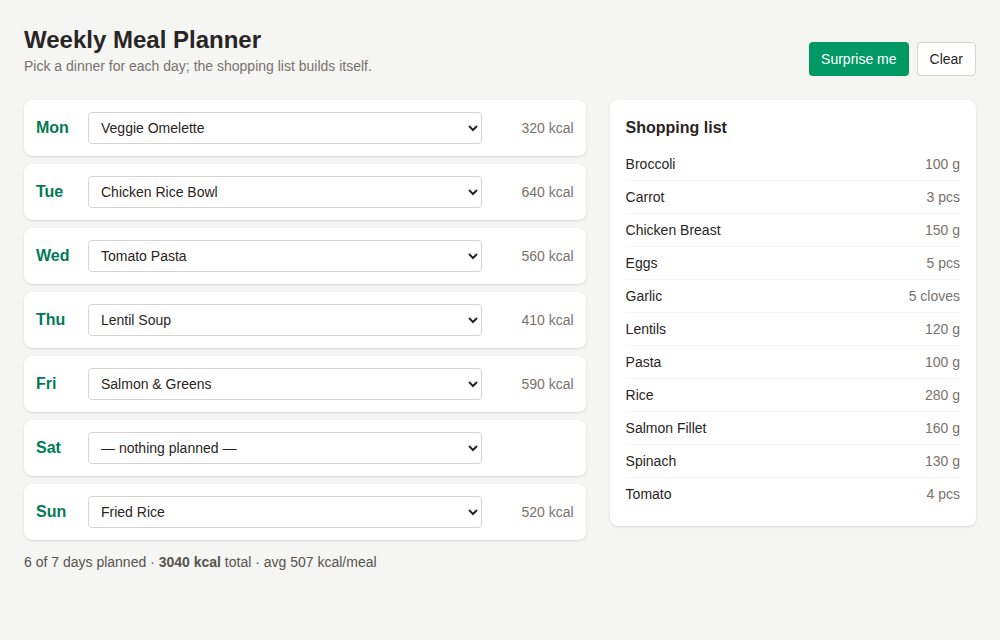

# Weekly Meal Planner

A Vue 3 page where you choose a dinner for each day of the week and get a merged shopping list and calorie total automatically.



*Real headless-Chromium screenshot of the production build with six days planned: 3040 kcal total, and ingredients such as rice (90 + 70 + 120 = 280 g) merged across recipes.*

## How to run

Requires Node.js 20+.

```bash
cd projects/2026-10-21-web-meal-planner   # or the repo root if published standalone
npm install
npm run dev          # http://localhost:5173
```

Production build and unit tests:

```bash
npm run build && npm run preview   # http://localhost:4173
npm test
```

## How it works

- One `<select>` per weekday; "Surprise me" fills the week with non-repeating recipes, "Clear" resets it.
- The Pinia store (`src/stores/plan.js`) derives total kcal and the shopping list from the assignments.
- `src/lib/shopping.js` sums ingredients with the same name and unit; it has unit tests.
- Recipes come from `mock/recipes.json` through `src/services/recipeSource.js`. A real recipe API can replace that one file if `list()` keeps resolving to the same shape.

## Stack

Vue 3 (`<script setup>`), Pinia, Vite 7, Tailwind CSS v4, `node:test`.

## Limitations

- Seven mock recipes only; no search, no portion scaling.
- The plan is held in memory and resets on reload.
- Only one meal (dinner) per day.
- Quantities are summed per unit only, so "2 pcs" and "200 g" of the same item stay separate lines.
