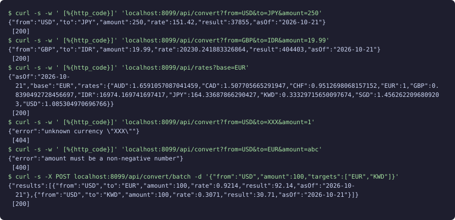

# Currency Converter API

A small Go HTTP API that converts amounts between currencies using a rate table read from a local fixture, rounding results to each currency's minor units.



The image is real `curl` output captured against the running server (rendered into an SVG).

## How to run

Requires only the Go toolchain (built with Go 1.24).

```sh
cd projects/2026-10-22-backend-currency-converter
go test ./...
go run .
```

Then, from another shell:

```sh
curl -s 'localhost:8080/api/convert?from=USD&to=JPY&amount=250'
curl -s 'localhost:8080/api/rates?base=EUR'
curl -s localhost:8080/api/currencies
curl -s -X POST localhost:8080/api/convert/batch \
  -d '{"from":"USD","amount":100,"targets":["EUR","KWD"]}'
```

`PORT` and `RATES_FILE` environment variables override the port (8080) and fixture path (`mock/rates.json`).

## API

| Method | Path | Notes |
|---|---|---|
| GET | `/health` | liveness |
| GET | `/api/currencies` | code, name, decimals, rate vs. base |
| GET | `/api/rates?base=XXX` | all cross rates; 404 for unknown base |
| GET | `/api/convert?from=&to=&amount=` | 400 bad amount, 404 unknown currency |
| POST | `/api/convert/batch` | one source, up to 50 targets; 400 bad body, 422 unknown target |

If the rate source fails to load, endpoints return 502.

## Stack

Go standard library only (`net/http` with method-aware routing). Rates sit behind the `RateSource` interface in `rates.go`; `FileSource` reads `mock/rates.json`. A live client would be a second implementation of that interface and a one-line change in `main.go`.

## Limitations

- Rates are a fixed, made-up snapshot (as of 2026-10-21), not market data.
- Amounts are `float64`, rounded only at the final result; fine for a demo, not for ledger-grade money handling.
- The fixture is re-read on every request; there is no caching, auth or rate limiting.
