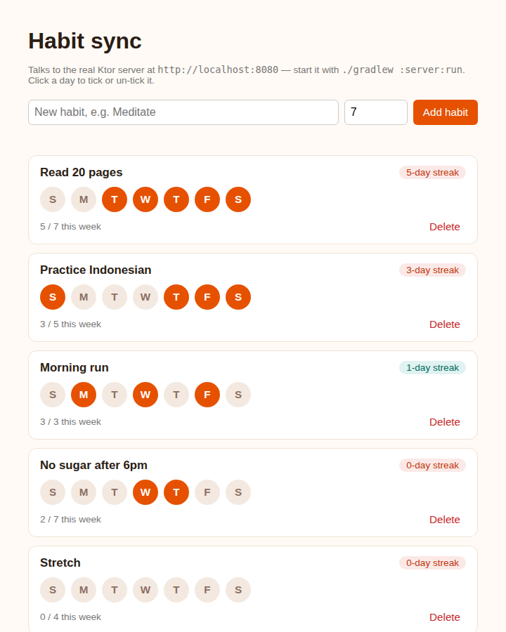

# Habit Sync

A habit tracker where every check-in lives on one Ktor server and shows up, with the same streak maths, in the Android, web and iOS clients: one Kotlin domain in `shared/`, four front ends.



*Real headless-Chromium screenshot of `webApp/` served next to the running `server/` — longest streak first, a dot per day for the last week, orange = done.*

## How to run

Needs JDK 17 and Node.js with Yarn on `PATH` (for the web bundle); the Android SDK only for `androidApp`. From a clean checkout of this folder:

```bash
# 1. Start the API on http://localhost:8080 (seeded from mock/habits.json)
./gradlew :server:run
```

```bash
# 2. In a second terminal: build and serve the web client, then open http://localhost:8000
./gradlew :webApp:jsBrowserDistribution
cd webApp/build/dist/js/productionExecutable && python3 -m http.server 8000
```

```bash
# Tests and full build (shared on JVM/Android, server, Android debug APK, web)
./gradlew build
```

```bash
# Android (emulator reaches the host server at 10.0.2.2:8080)
./gradlew :androidApp:assembleDebug
```

```bash
# iOS (macOS with Xcode only) — open iosApp/Package.swift in Xcode, or:
cd iosApp && swift test
```

### API

| Method & path | Result |
|---|---|
| `GET /habits` | `200`, every habit with its `checkIns` (ISO dates) |
| `POST /habits` `{"name","goalPerWeek"}` | `201` with the new habit; `400` `{"message"}` for blank/over-40-char name, goal outside 1–7, or malformed JSON |
| `POST /habits/{id}/checkins` `{"date":"YYYY-MM-DD"}` | `200` with the habit, date ticked or un-ticked (toggle); `400` bad/future date or non-numeric id; `404` unknown id |
| `DELETE /habits/{id}` | `204`; `404` unknown id |

Streaks and the weekly count are computed client-side by the shared use cases, so the server stays a dumb store of dates.

Real output from the running server (`./gradlew :server:installDist`, then `curl` with `Content-Type: application/json`):

```text
$ curl -X POST localhost:8080/habits -d '{"name":"Meditate","goalPerWeek":4}'
HTTP/1.1 201 Created { "id": 6, "name": "Meditate", "goalPerWeek": 4, "checkIns": [] }
$ curl -X POST localhost:8080/habits -d '{"name":"x","goalPerWeek":9}'
HTTP/1.1 400 Bad Request { "message": "Goal must be between 1 and 7 days a week" }
$ curl -X POST localhost:8080/habits -d '{"name":'
HTTP/1.1 400 Bad Request { "message": "Request body must be valid JSON for this endpoint" }
$ curl -X POST localhost:8080/habits/5/checkins -d '{"date":"2026-10-24"}'
HTTP/1.1 200 OK { "id": 5, "name": "Stretch", "goalPerWeek": 4, "checkIns": [ "2026-10-24" ] }
$ curl -X POST localhost:8080/habits/5/checkins -d '{"date":"2026-10-24"}'
HTTP/1.1 200 OK { "id": 5, "name": "Stretch", "goalPerWeek": 4, "checkIns": [] }
$ curl -X POST localhost:8080/habits/5/checkins -d '{"date":"2099-01-01"}'
HTTP/1.1 400 Bad Request { "message": "You cannot check in on a future date" }
$ curl -X POST localhost:8080/habits/5/checkins -d '{"date":"tomorrow"}'
HTTP/1.1 400 Bad Request { "message": "Date must look like YYYY-MM-DD" }
$ curl -X POST localhost:8080/habits/99/checkins -d '{"date":"2026-10-24"}'
HTTP/1.1 404 Not Found { "message": "No habit with id 99" }
```

## Stack

- **`shared/`** (`commonMain`; targets `jvm`, Android, `iosX64`/`iosArm64`/`iosSimulatorArm64`, `js(IR)`): `Habit`, `HabitRepository`, `kotlinx-datetime` streak and week maths, and four use cases (`List`, `Add`, `ToggleCheckIn`, `Remove`) returning a `HabitResult` sealed class. Unit-tested in `commonTest`.
- **`server/`**: Ktor + Netty, mutex-guarded in-memory repository seeded from `mock/habits.json` (check-ins stored as "days ago" so the seed always has live streaks). Calls the same shared use cases the clients do.
- **`androidApp/`**: Jetpack Compose + Material 3, `ViewModel` + `StateFlow`, Ktor client behind `HttpHabitRepository` — swap that one file for another backend.
- **`webApp/`**: Kotlin/JS, plain DOM, Ktor JS client behind `HttpHabitRepository`, driving the shared use cases; click any of the last seven days to toggle it.
- **`iosApp/`**: Swift 6, SwiftUI, `@Observable`, SwiftPM, `URLSession` behind `HttpHabitRepository`.

## Verified on this runner

- `./gradlew build` — **passes**: shared tests, Ktor `testApplication` server tests, Android debug build and lint, web bundle.
- Server started and exercised with `curl` (output above); web client screenshot taken against the live server.

## Limitations

- **The iOS app was not built or run at authoring time** (Linux runner, no Xcode). It also does **not** link the compiled `shared` module: Kotlin/Native only produces Apple targets on macOS and nothing here builds an `.xcframework`, so `iosApp/` is a hand-written Swift mirror of the same JSON contract and streak rules, with its own XCTest suite.
- **The Android app was built (`assembleDebug`, lint) but never launched** — no emulator here. The UI screenshot above is the web client, not Android.
- "Sync" means every client sees the same server-side data on refresh; there is no push or live update between devices.
- The server judges "today" in its own time zone for the future-date check, while each client picks its own local day; near midnight across zones a client can be refused a date that is still "today" for it.
- Persistence is in-memory: restarting the server resets to the seed file. No auth, no per-user data.
- The web client needs the two terminals above; the API allows any origin (CORS `anyHost`), which is fine for local dev only.
