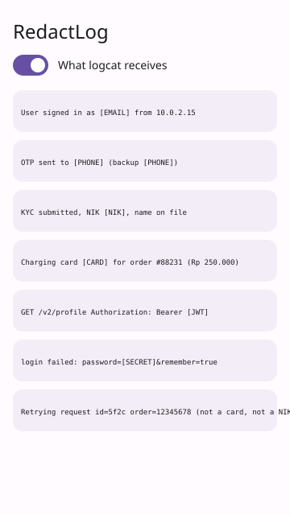

# RedactLog

An Android logging wrapper that scrubs emails, Indonesian phone numbers, NIK, card numbers, tokens and `password=...` pairs from every message and stack trace before it reaches logcat (or any sink you plug in).



*UI mockup (hand-drawn SVG, not a screenshot).*

## How to run

Needs JDK 17 and the Android SDK (`ANDROID_HOME` set, or `local.properties` with `sdk.dir`).

```bash
./gradlew build                 # compiles library + sample, runs the unit tests
./gradlew :redactlog:test       # library unit tests only
./gradlew :sample:installDebug  # install the sample on a device/emulator
```

## Use it

After `./gradlew :redactlog:publishToMavenLocal`:

```kotlin
implementation("com.dailyprojects.redactlog:redactlog:1.0.0")
```

```kotlin
val log = RedactingLogger()                       // writes to logcat
log.i("auth", "login ok for budi@example.co.id")  // -> login ok for [EMAIL]
log.e("pay", "declined", exception)               // stack trace is scrubbed too

// extra rule, or a different sink (file, Crashlytics, ...):
val custom = RedactingLogger(
    sink = LogSink { level, tag, msg -> myFileWriter.append("$level $tag $msg") },
    redactor = Redactor() + Rule("plate", Regex("""\b[A-Z]{1,2} \d{1,4} [A-Z]{1,3}\b"""), "[PLATE]"),
)
```

Rules, applied in order: `jwt`, `bearer`, `secret` (password/token/api_key/otp/pin pairs, key kept), `email`, `nik`, `card` (Luhn-checked), `phone` (+62 / 62 / 08x). `Redactor.matchedRules(text)` reports which fired.

The sample reads raw lines from `mock/lines.json` (via `LineSource`, one class to swap) and shows them next to what the logger emits.

## Stack

Kotlin, Android Gradle Plugin 8.6, Gradle KTS, Jetpack Compose + Material 3 (sample only), JUnit 4. The library has no dependencies beyond `android.util.Log`.

## Limitations

- Verified on this runner: `./gradlew build` passes (library, sample APK assembled, 10 unit tests green). The sample was never launched: no emulator here, so the preview is a mockup.
- Regex based: it will miss PII in free-form text (names, addresses) and a very short digit run can look like a phone number. Treat it as a safety net, not a compliance guarantee.
- Only strings passed to the logger are scrubbed; direct `Log.d` calls elsewhere are not.
