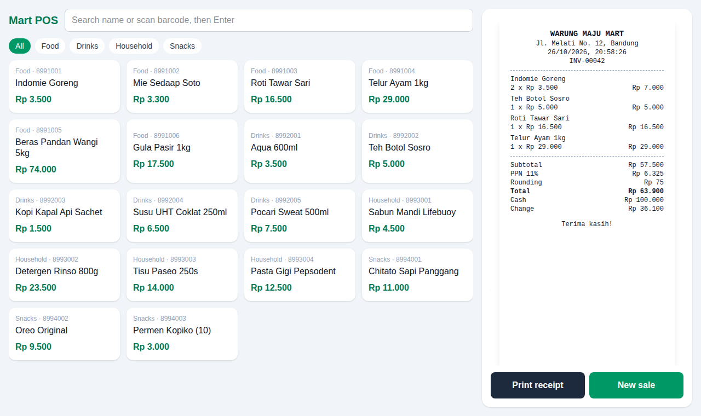

# Mart POS

A Vue 3 point-of-sale screen for a small mini-mart: tap or scan products into a cart, take cash with quick-cash buttons, and print an 80 mm receipt with PPN 11% and Rp 100 cash rounding.



*Real headless-Chromium screenshot of the built app, taken right after charging a sale (also at `preview.png`).*

## How to run

```bash
cd projects/2026-10-26-freelance-mart-pos   # or the repo root if published standalone
npm install
npm test             # 5 unit tests for the cart maths (Node 22+)
npm run build        # type-checks with vue-tsc, then builds
npm run dev          # http://127.0.0.1:5173
```

To serve the production build instead: `npm run preview` (http://127.0.0.1:4173).

Using it: click products (or type a name/SKU that matches exactly one product and press Enter), adjust quantities with − / +, pick a quick-cash amount or type the cash received, press **Charge**, then **Print receipt** (the print stylesheet prints only the receipt at 80 mm width).

## How it works

- `mock/products.json` is the product catalogue (18 Indonesian mart items, prices in Rupiah).
- `src/catalog.ts` defines the `CatalogSource` interface (`list`, `nextReceiptNo`) and an in-memory mock. A real API client replaces only that file's export.
- `src/cart.ts` holds the pure logic: add/set quantity, subtotal + PPN, cash rounding, quick-cash suggestions, search.
- `src/App.vue` is the register screen; `src/Receipt.vue` is the printable receipt.

## Stack

Vue 3 (`<script setup>`), Vite 7, Tailwind CSS v4, TypeScript.

## Limitations

- Mock catalogue only; there is no stock tracking, barcode hardware integration, or persistence — reloading clears the sale and the receipt counter.
- Cash payments only; no card, split payment, discounts or refunds.
- Shop name and address on the receipt are fixed sample values.
- The screenshot was taken with Chromium headless; actual printing was not tested on a thermal printer.
