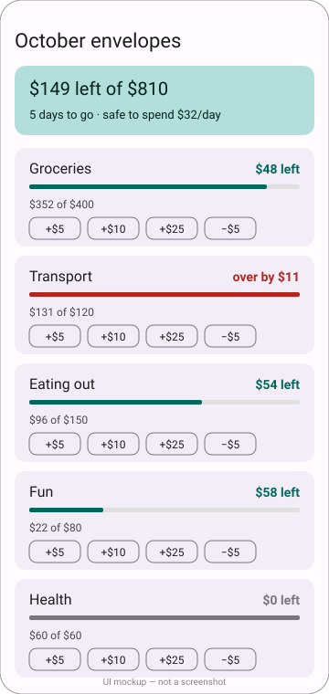

# Budget Envelopes

An Android app that splits a month's budget into spending envelopes, shows how much is left in each, flags the ones that are nearly empty or overspent, and works out what you can safely spend per day.



*UI mockup, hand-drawn — not a screenshot. The app was compiled but never launched.*

## How to run

Requires a JDK 17 and the Android SDK (`ANDROID_HOME` set, or `sdk.dir` in `local.properties`).

```bash
./gradlew assembleDebug
# install on a connected device or emulator
adb install -r app/build/outputs/apk/debug/app-debug.apk
```

## How it works

- Each envelope has a budget and an amount spent, loaded from `mock/budget.json` through the `BudgetRepository` interface. Replacing `LocalBudgetRepository` is the only change needed for a real backend.
- Tap `+$5`, `+$10` or `+$25` to record a spend; `−$5` undoes one (spent never drops below zero).
- Status colours: teal under 80% used, amber at 80% or more, grey when exactly empty, red when over budget.
- "Safe to spend per day" = money left in envelopes that are not overspent, divided by days remaining. An overspent envelope does not eat into the others' allowance.

## Stack

Kotlin, Jetpack Compose, Material 3, ViewModel + StateFlow, Gradle Kotlin DSL (AGP 8.6, Kotlin 2.0.20).

## Limitations

- `./gradlew assembleDebug` passes on the build runner, but the app was never run: no emulator or device was available, so the layout is unverified on screen.
- Changes live in memory only; nothing is persisted between launches.
- Amounts are whole dollars, a single currency, and there is no way to add or rename envelopes.
- The mock file is duplicated in `app/src/main/assets/mock/` because Android reads assets from inside the module.
