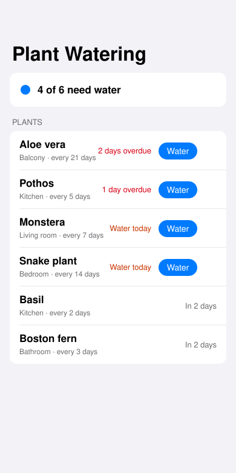

# Plant Watering

A single-screen SwiftUI app that lists your houseplants by urgency, shows which are overdue or due today, and lets you mark one watered with a tap.



*Hand-drawn UI mockup, not a screenshot — see Limitations.*

## How to run

Requires Swift 6+. The logic and fixture loading (`PlantCore`) build and test on Linux or macOS; the UI needs Xcode on macOS.

```bash
cd projects/2026-10-28-ios-plant-watering
swift test    # on macOS
```

To see the screen: open `Package.swift` in Xcode, add an iOS App target that depends on the `PlantWatering` library, and show `PlantRootView()` in your own `WindowGroup` (the library also contains a `PlantApp` entry point). Run it in the simulator.

On Linux, `swift test` fails to build the `PlantWatering` UI target (`no such module 'SwiftUI'`). To run only the logic tests there, build a copy of the package without that target.

## Stack

- Swift 6, SwiftUI, `@Observable` store (`PlantStore`), Swift Package Manager, no dependencies
- `PlantCore`: Foundation-only models and rules (UTC day arithmetic across month and year boundaries, overdue / due / upcoming status, urgency sorting)
- Plants are read from `mock/plants.json` (copied into `Sources/PlantCore/Resources/` as a package resource) through the `PlantRepository` protocol — a real client replaces `MockPlantRepository` in one file
- Tests in `Tests/PlantCoreTests` use the `Testing` framework

## Limitations

- **The SwiftUI screen was written but not built or run.** This runner is Linux with no Xcode or simulator. `preview.svg` is a hand-drawn UI mockup. The `verify-ios` job on macOS is the first real compile of the UI.
- **Verified here:** `PlantCore` built and all 6 unit tests passed on Linux, using a copy of the package without the UI target.
- "Today" is fixed to 2026-10-28 so the fixture data stays meaningful. Watering is held in memory only; nothing is saved between launches.

- **iOS build: passing.** Compiled on macOS against the iOS 17 simulator SDK by the `verify-ios` job.
