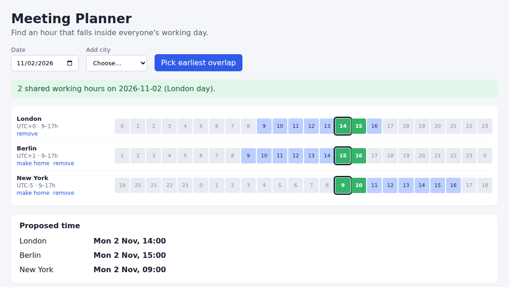

# Meeting Planner

A Nuxt 4 single-page tool that lays cities' working hours side by side and highlights the hours when everyone is at work, so you can pick a meeting time.



*Real headless-Chromium screenshot of the running build (London, Berlin, New York on 2026-11-02; green = everyone's working day).*

## How to run

Requires Node 20+.

```bash
npm install
npm run dev        # http://localhost:3000
```

Production build:

```bash
npm run build
node .output/server/index.mjs
```

## What you can do

- Add and remove cities; the first row is the "home" city that defines the 24-hour day shown (use *make home* to change it).
- Change the date: daylight-saving shifts are handled by `Intl.DateTimeFormat`, so the grid is correct either side of a clock change.
- Click any hour (or *Pick earliest overlap*) to see the local date and time in every city, with a warning where it falls outside working hours.

## Stack

Nuxt 4 (SPA mode, `ssr: false`), Vue 3 Composition API with `<script setup>`, TypeScript, plain CSS. No runtime dependencies beyond Nuxt.

City data lives in `mock/cities.json` and is read through the `CityService` interface in `app/services/cityService.ts`; replacing that one file with an HTTP client is all it takes to use a real source.

## Verification

Built with `nuxt build` and run with `node .output/server/index.mjs`. Driven with headless Chromium: the default view reports 2 shared hours; picking the earliest overlap yields London 14:00, Berlin 15:00, New York 09:00 (EST after the 1 Nov clock change); adding Jakarta correctly drops the overlap to none. No browser console errors.

## Limitations

- Working hours are one fixed window per city, with no weekends, lunch breaks or per-person schedules.
- Only 10 cities in the mock list; the grid is hourly, so half-hour-offset zones are shown correctly but meetings are not proposed on the half hour.
- State is not persisted; reloading resets to the default cities and date.
- No automated tests.
