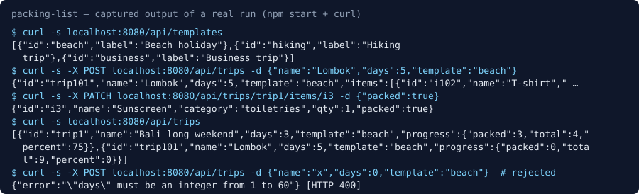

# Packing List API

A small TypeScript (Hono) backend that generates a packing list for a trip from a template, scaling clothes by trip length, and tracks what has been packed.



The image is the real terminal output of running the server and exercising it with curl, rendered as SVG text.

## How to run

Requires only Node.js (developed with Node 22).

```sh
cd projects/2026-10-30-backend-packing-list
npm install
npm run build   # type-check
npm test        # in-process checks of every endpoint
npm start       # http://localhost:8080  (PORT=... to change)
```

From another shell:

```sh
curl -s localhost:8080/api/templates
curl -s -X POST localhost:8080/api/trips -H 'Content-Type: application/json' \
  -d '{"name":"Lombok","days":5,"template":"beach"}'
curl -s localhost:8080/api/trips
curl -s localhost:8080/api/trips/trip1
curl -s -X PATCH localhost:8080/api/trips/trip1/items/i3 -H 'Content-Type: application/json' -d '{"packed":true}'
curl -s -X POST localhost:8080/api/trips/trip1/items -H 'Content-Type: application/json' \
  -d '{"name":"Snorkel","category":"gear","qty":1}'
curl -s -X DELETE localhost:8080/api/trips/trip1/items/i4
```

Validation errors return 400, unknown trips or items 404.

## Stack

TypeScript, Hono, `@hono/node-server`, tsx. Seed data lives in `mock/templates.json` and `mock/trips.json`, read through the `PackingStore` interface in `src/store.ts`; replacing that one file with a database implementation is all a real backend needs.

## Limitations

- State is in memory and resets on restart.
- No authentication or per-user trips.
- Quantities are `ceil(perDay × days)` capped by `max`; there is no weather or luggage-weight logic.
