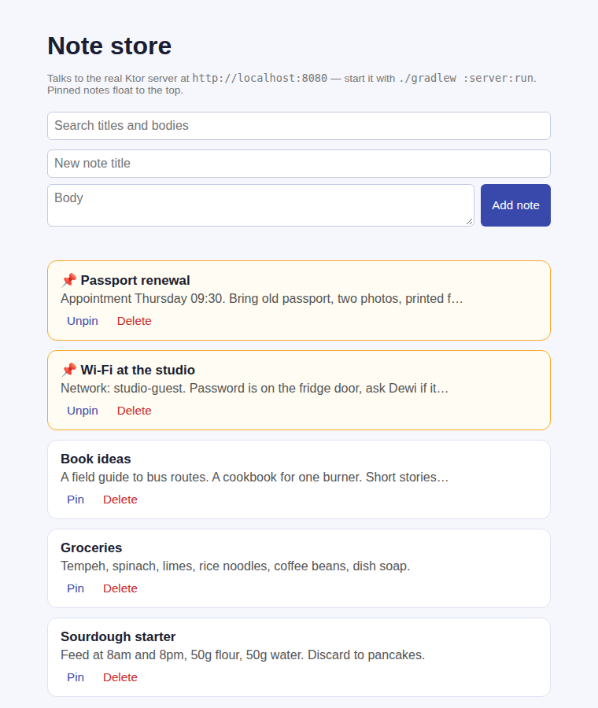

# Note Store

A pinned-notes app where every note lives on one Ktor server and shows up, with the same search and pin-first ordering, in the Android, web and iOS clients: one Kotlin domain in `shared/`, four front ends.



*Real headless-Chromium screenshot of `webApp/` served next to the running `server/` (after a few curl calls added one note and deleted another). Pinned notes get an amber border and float to the top; the rest are alphabetical.*

## How to run

Needs JDK 17 and Node.js with Yarn on `PATH` (for the web bundle); the Android SDK only for `androidApp`. From a clean checkout of this folder:

```bash
# 1. Start the API on http://localhost:8080 (seeded from mock/notes.json)
./gradlew :server:run
```

```bash
# 2. In a second terminal: build and serve the web client, then open http://localhost:8000
./gradlew :webApp:jsBrowserDistribution
cd webApp/build/dist/js/productionExecutable && python3 -m http.server 8000
```

```bash
# Tests and full build (shared on JVM/Android, server, Android debug APK, web)
./gradlew build
```

```bash
# Android (emulator reaches the host server at 10.0.2.2:8080)
./gradlew :androidApp:assembleDebug
```

```bash
# iOS (macOS with Xcode only) — open iosApp/Package.swift in Xcode, or:
cd iosApp && swift test
```

### API

| Method & path | Result |
|---|---|
| `GET /notes` | `200`, every note (`id`, `title`, `body`, `pinned`) |
| `POST /notes` `{"title","body"}` | `201` with the new note; `400` `{"message"}` for blank/over-60-char title, body over 500 chars, or malformed JSON |
| `POST /notes/{id}/pin` | `200` with the note, pin flag flipped; `400` non-numeric id; `404` unknown id |
| `DELETE /notes/{id}` | `204`; `400` non-numeric id; `404` unknown id |

Search and ordering are done client-side by the shared `arrange` function, so the server stays a plain store.

Real output from the running server (`./gradlew :server:installDist`, then `curl` with `Content-Type: application/json`):

```text
$ curl -X POST localhost:8080/notes -d '{"title":"Sourdough starter","body":"Feed at 8am and 8pm, ..."}'
HTTP/1.1 201 Created  { "id": 6, "title": "Sourdough starter", "body": "Feed at 8am and 8pm, ...", "pinned": false }
$ curl -X POST localhost:8080/notes -d '{"title":"  "}'
HTTP/1.1 400 Bad Request  { "message": "Give the note a title" }
$ curl -X POST localhost:8080/notes -d '{"title":'
HTTP/1.1 400 Bad Request  { "message": "Request body must be valid JSON for this endpoint" }
$ curl -X POST localhost:8080/notes/2/pin     (twice)
HTTP/1.1 200 OK  { "id": 2, "title": "Groceries", ..., "pinned": true }   then   "pinned": false
$ curl -X POST localhost:8080/notes/99/pin
HTTP/1.1 404 Not Found  { "message": "No note with id 99" }
$ curl -X POST localhost:8080/notes/abc/pin
HTTP/1.1 400 Bad Request  { "message": "id must be a number" }
$ curl -X DELETE localhost:8080/notes/5       (twice)
HTTP/1.1 204 No Content   then   HTTP/1.1 404 Not Found  { "message": "No note with id 5" }
```

## Stack

- **`shared/`** (`commonMain`; targets `jvm`, Android, `iosX64`/`iosArm64`/`iosSimulatorArm64`, `js(IR)`): `Note`, `NoteRepository`, validation, preview, search and ordering rules, and four use cases (`List`, `Add`, `TogglePin`, `Remove`) returning a `NoteResult` sealed class. Unit-tested in `commonTest`.
- **`server/`**: Ktor + Netty, mutex-guarded in-memory repository seeded from `mock/notes.json`, calling the same shared use cases the clients do. Tested with `testApplication`.
- **`androidApp/`**: Jetpack Compose + Material 3, `ViewModel` + `StateFlow`, Ktor client behind `HttpNoteRepository` — swap that one file for another backend.
- **`webApp/`**: Kotlin/JS, plain DOM, Ktor JS client behind `HttpNoteRepository`, driving the shared use cases; the search box filters as you type.
- **`iosApp/`**: Swift 6, SwiftUI, `@Observable`, SwiftPM, `URLSession` behind `HttpNoteRepository`, with an XCTest suite.

## Verified on this runner

- `./gradlew build` — **passes**: shared tests, Ktor server tests, Android debug build and lint, web bundle.
- Server started and exercised with `curl` (output above); web client screenshot taken against the live server.

## Limitations

- **The iOS app was not built or run at authoring time** (Linux runner, no Xcode). It also does **not** link the compiled `shared` module: Kotlin/Native only produces Apple targets on macOS and nothing here builds an `.xcframework`, so `iosApp/` is a hand-written Swift mirror of the same JSON contract and rules, with its own tests. The `verify-ios` job compiles it on macOS after the project lands.
- **The Android app was built (`assembleDebug`, lint) but never launched** — no emulator here. The screenshot above is the web client, not Android.
- There is no edit-note endpoint: a note's title and body are fixed once added (pin and delete only).
- "Sync" means every client sees the same server data on refresh; there is no push between devices.
- Persistence is in-memory: restarting the server resets to the seed file. No auth, no per-user data.
- The API allows any origin (CORS `anyHost`) and Android allows cleartext HTTP, both for local dev only.
