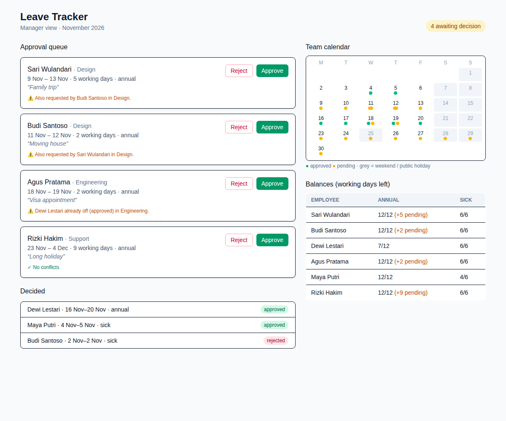

# Leave Tracker

A manager's leave-approval screen: a queue of pending requests with balance and team-conflict warnings, a month calendar of who is off, and per-employee leave balances.



*Real headless-Chromium screenshot of the built app (`preview.svg` embeds the same image).*

## How to run

```bash
cd projects/2026-11-03-freelance-leave-tracker   # or the repo root if published standalone
npm install
npm run dev        # http://127.0.0.1:5173
```

Production build and preview:

```bash
npm run build      # type-checks, then bundles
npm run preview    # http://127.0.0.1:4173
```

## What it does

- **Approve / Reject** moves a request out of the queue and updates balances and calendar immediately.
- Working days exclude weekends and public holidays (25 Nov in the fixture).
- **Approve is disabled** when a request needs more days than the employee has left.
- Warns when a same-team colleague is already off (approved) or has a competing pending request on overlapping dates.

## Stack

React 19, Vite 7, Tailwind CSS v4, TypeScript. All data comes from `mock/leave.json` through the `LeaveSource` interface in `src/leaveSource.ts`; replacing that one file with a `fetch` client connects a real backend. Date and balance logic is pure and lives in `src/leave.ts`.

## Limitations

- State is in memory: reloading the page resets all decisions.
- No request-submission form, no login, no roles; it is the manager view only.
- Single month (November 2026) from the fixture; no half days or carry-over rules.
- Verified by `npm run build` and a headless screenshot of the initial state. Button interactions were not driven by an automated test.
