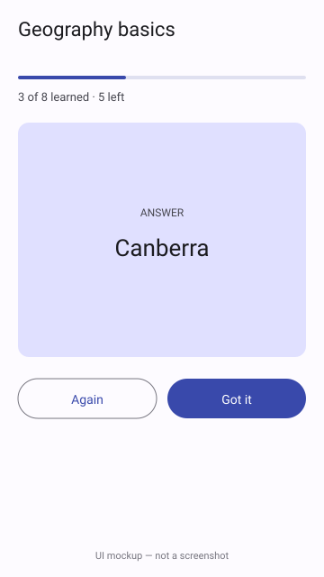

# Flashcards

A one-screen Android flashcard trainer: tap a card to reveal the answer, mark it "Got it" or "Again", and missed cards come back until the whole deck is learned.



*UI mockup, hand-drawn SVG — not a screenshot.*

## How to run

Requires JDK 17 and the Android SDK (`ANDROID_HOME` set, platform 35).

```bash
cd projects/2026-11-04-android-flashcards
./gradlew assembleDebug
adb install -r app/build/outputs/apk/debug/app-debug.apk
```

Or open the folder in Android Studio and press Run.

## Stack

Kotlin, Jetpack Compose, Material 3, ViewModel + StateFlow, Gradle KTS. The deck is read from `app/src/main/assets/mock/flashcards.json` (copy in `mock/`) through the `DeckRepository` interface; replacing `LocalDeckRepository.kt` is the only change needed for a real backend.

## Limitations

- `./gradlew assembleDebug` was run and passes, but the app was **never launched**: the runner has no emulator or device. The preview is a mockup.
- No persistence: progress resets when the process dies.
- No unit tests, and a single bundled deck.
